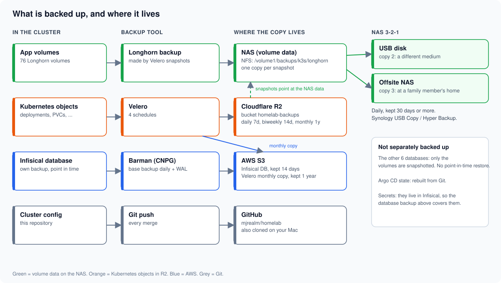

# What is backed up, and where

Read this to know which copy to restore from, and how to check that the backups
are healthy. It describes the setup as it is today.



## The copies

| What | Made by | Where it lives | How often | Kept for | Restore from |
|---|---|---|---|---|---|
| App volume data (every Longhorn volume) | Longhorn backups, triggered by Velero's volume snapshots | The NAS, over NFS (`defaultBackupStore.backupTarget` in `k8s/bootstrap/charts/longhorn-system/values.yaml`) | With each Velero backup below | Until you prune them (see the note below) | Velero restore, which makes each volume from its NAS backup |
| Kubernetes objects and volume references | Velero schedule `velero-daily-backup` | Cloudflare R2 bucket `homelab-backups` | Daily at 03:01 (Pacific). Only the namespaces listed under `daily-backup` in `k8s/system/velero/values.yaml`, the apps whose data changes every day | 7 days | `velero restore create --from-backup` |
| Everything, all namespaces | Velero schedule `velero-biweekly-backup` | R2 | Sunday and Wednesday at 04:00 | 14 days | Same |
| Everything, long term | Velero schedule `velero-monthly-backup` | R2 | 1st of the month at 03:30 | 1 year | Same |
| Everything, second provider | Velero schedule `velero-monthly-backup-aws` | An AWS S3 bucket, location `aws` | 1st of the month at 04:30 | 1 year | Same, with `--storage-location aws` |
| Infisical's database (all secrets) | CloudNativePG with the Barman plugin | An AWS S3 bucket | Base backup daily at 03:00 UTC, plus every WAL file as it fills | 14 days | The recovery guide, step 3 |
| Application databases that have their own backup | CloudNativePG with the Barman plugin | Cloudflare R2 bucket `homelab-db-backups`, one folder per app | Base backup daily (see [Backup schedule](03-backup-schedule.md)), plus every WAL file | 14 days | A `recovery` bootstrap from the app's `<app>-r2` store (restore not yet tested) |
| This repository (all cluster configuration) | Git | GitHub, and your clone | Every merge | Forever | `git clone` |
| Secret values you type during a rebuild | You | Bitwarden | When they change | Bitwarden's own history | The recovery guide, "What you need" |

The schedules, namespaces and retention are defined in
`k8s/system/velero/values.yaml`, the Infisical backup in
`k8s/bootstrap/charts/infisical/values.yaml`, and each application database's backup
under `backup.r2` in the app's `values.yaml`. Those files are the source of truth.
A database has its own backup only if its chart has a Barman `ObjectStore`; list them
with `kubectl get objectstores.barmancloud.cnpg.io -A`.

Velero holds the **Kubernetes objects** and a **reference** to each volume's
backup. The **volume data** is on the NAS. Both are needed: Velero without the NAS
brings back empty volumes, and the NAS without Velero has data but no Kubernetes
objects pointing at it.

Longhorn does not delete a volume's backups when the Velero backup that created
them expires, because the volume snapshot class uses `deletionPolicy: Retain`. The
backups on the NAS therefore grow until you prune them. Check the NAS free space now and then, and prune old backups in the
Longhorn web page (**Backup**) if it runs low.

## Backups never overlap the Longhorn snapshots

Velero takes the Longhorn CSI snapshots, so database base backups run in a separate
window, at least an hour away. `make check-backups` enforces it, and CI runs it on
every push. The times and the rule are on [Backup schedule](03-backup-schedule.md).

## The 3-2-1 rule on the NAS

The NAS holds the only copy of the volume data, so it follows the 3-2-1 rule:

- **3 copies**: the data on the NAS, a copy on a USB disk, and a copy on an
  offsite NAS.
- **2 media**: the NAS disks, and the USB disk.
- **1 offsite**: a NAS at a family member's home.

Both extra copies run daily and are kept for 30 days or more. The USB copy is a
Synology task (USB Copy or Hyper Backup). If the NAS itself is lost, restore the
shares from the USB disk or the offsite NAS first, and then run the cluster
recovery.

## What is not separately backed up

- **Databases without a Barman `ObjectStore`.** They run on CloudNativePG too, but
  only some have their own backup (see the table above). The others come back only
  as volume snapshots from the NAS, which are crash-consistent. You cannot restore them to a chosen point in time.
- **Argo CD's state**: it is rebuilt from Git.
- **Secrets**: they live in Infisical, so the Infisical database backup covers
  them. The three keys that open that database (`ENCRYPTION_KEY`, `AUTH_SECRET`,
  `REDIS_PASSWORD`) are in AWS Systems Manager and in Bitwarden.

## Check that the backups are healthy

Run these from the repo root, in the Terminal. They only read.

1. Velero can reach both buckets:

   ```bash
   velero backup-location get
   ```

   Expect every location in the table above (`r2` and `aws`) `Available`, with
   `LAST VALIDATED` within the last few minutes.

2. The schedules run:

   ```bash
   velero schedule get
   velero backup get | head -8
   ```

   Expect every schedule in the table above `Enabled`, and recent backups with the status
   `Completed` and `ERRORS` `0`. The newest `velero-daily-backup-*` should be
   less than 25 hours old.

3. Longhorn can reach the NAS:

   ```bash
   kubectl -n longhorn-system get backuptargets.longhorn.io
   ```

   Expect `AVAILABLE` `true` and a recent `LASTSYNCEDAT`.

4. The database backups run:

   ```bash
   kubectl get scheduledbackup -A
   kubectl get backups.postgresql.cnpg.io -A | tail -8
   ```

   Expect every schedule to show `LAST BACKUP` within the last 25 hours and the
   newest backups `completed`.

5. The NAS copies ran. In the Synology DSM web page, open the USB Copy or Hyper
   Backup task and the offsite task, and check that the last run was
   successful and is less than a day old.

If any check fails, fix it the same day. A backup that quietly stopped is the most
common way to find out too late.

## Test a restore

A backup you have never restored is only a hope.

- **Infisical's database**: `make test-dr` restores it from a backup into a new
  throwaway cluster and checks the data. See
  [Try a change on a throwaway cluster](../operate/05-test-cluster.md).
- **App volumes**: not tested yet. Restoring one small volume into a test
  namespace once or twice a year would prove that Velero, Longhorn and the NAS
  work together.
