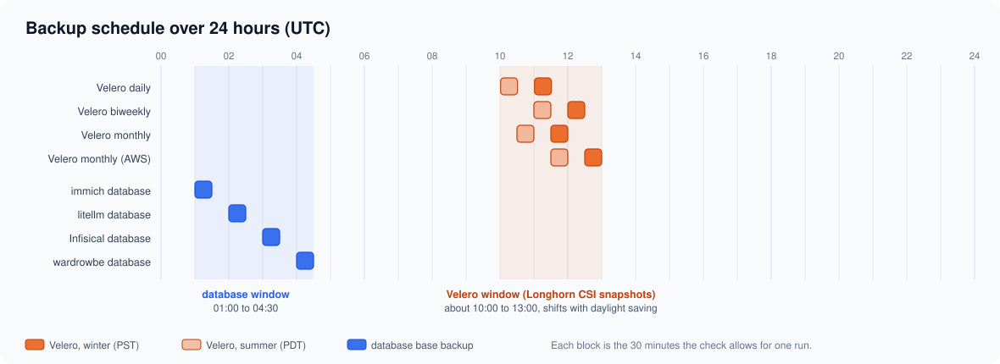

# Backup schedule

Read this before you add or move a backup. It shows when every backup runs, and the
rule that keeps database backups away from the Longhorn snapshots.



## The rule

Velero takes the Longhorn CSI snapshots, so a database base backup must not run while
Velero does.

- A database base backup stays at least 60 minutes away from every Velero run, in
  winter and in summer.
- Two database base backups stay at least 30 minutes apart.
- Database base backups start between 01:00 and 05:00 UTC, one per hour.
- Continuous WAL archiving cannot be scheduled. It is a small upload whenever a log
  file fills, and it does not count.

The check allows 30 minutes for each run. Velero's longest run is about half of
that, and a database base backup is much shorter.

## When each backup runs

Velero runs in Pacific time, and daylight saving moves it by one hour in UTC. The
database backups run in UTC and never move.

| Backup | Defined in | Local time (Pacific) | UTC, winter | UTC, summer |
|---|---|---|---|---|
| Velero `daily-backup` | `k8s/system/velero/values.yaml` | 03:01 every day | 11:01 | 10:01 |
| Velero `biweekly-backup` | same | 04:00 Sunday and Wednesday | 12:00 | 11:00 |
| Velero `monthly-backup` | same | 03:30 on the 1st | 11:30 | 10:30 |
| Velero `monthly-backup-aws` | same | 04:30 on the 1st | 12:30 | 11:30 |
| Immich database (Sundays only) | `backup.r2.schedule` in `k8s/apps/immich/values.yaml` | | 01:00 | 01:00 |
| LiteLLM database | `backup.r2.schedule` in `k8s/ai/litellm/values.yaml` | | 02:00 | 02:00 |
| Infisical database | `backup.schedule` in `k8s/bootstrap/charts/infisical/values.yaml` | | 03:00 | 03:00 |
| Wardrowbe database | `backup.r2.schedule` in `k8s/apps/wardrowbe/values.yaml` | | 04:00 | 04:00 |
| Sure database | `backup.r2.schedule` in `k8s/apps/sure/values.yaml` | | 05:00 | 05:00 |

The files are the source of truth. To print the current times and check the rule,
run this in the Terminal, from the repo root:

```bash
make check-backups
```

Expect a list of the Velero and database times, and a last line starting with
`ok: every database backup is at least 60 min from Velero's snapshots`. A line
starting `FAIL:` names the two backups that are too close.

## Add a database backup

1. Choose a free hour between 01:00 and 05:00 UTC that no other database backup uses.
2. Put it in the app's `values.yaml` as the six-field cron `0 0 <hour> * * *` under
   `backup.r2.schedule` (seconds, minutes, hours, day, month, weekday, in UTC).
3. Run `make check-backups`. It must end with `ok:`. CI runs the same check on every
   push, so a pull request that breaks the rule fails.

If no hour in the band is free, widen the band only after checking the output of
`make check-backups`. Never move a database backup into the Velero window.

## What the check cannot see

Longhorn's own recurring jobs (volume trim and snapshot cleanup) are set in the
Longhorn web page, not in Git, so the check cannot read them. They run in UTC. Keep
them outside the Velero window too. List them with:

```bash
kubectl -n longhorn-system get recurringjobs.longhorn.io -o 'custom-columns=NAME:.metadata.name,TASK:.spec.task,CRON:.spec.cron'
```

Expect each `CRON` to put the job outside the Velero times in the table above. A
cron `1 0 * * *` runs at 00:01 UTC every day.
